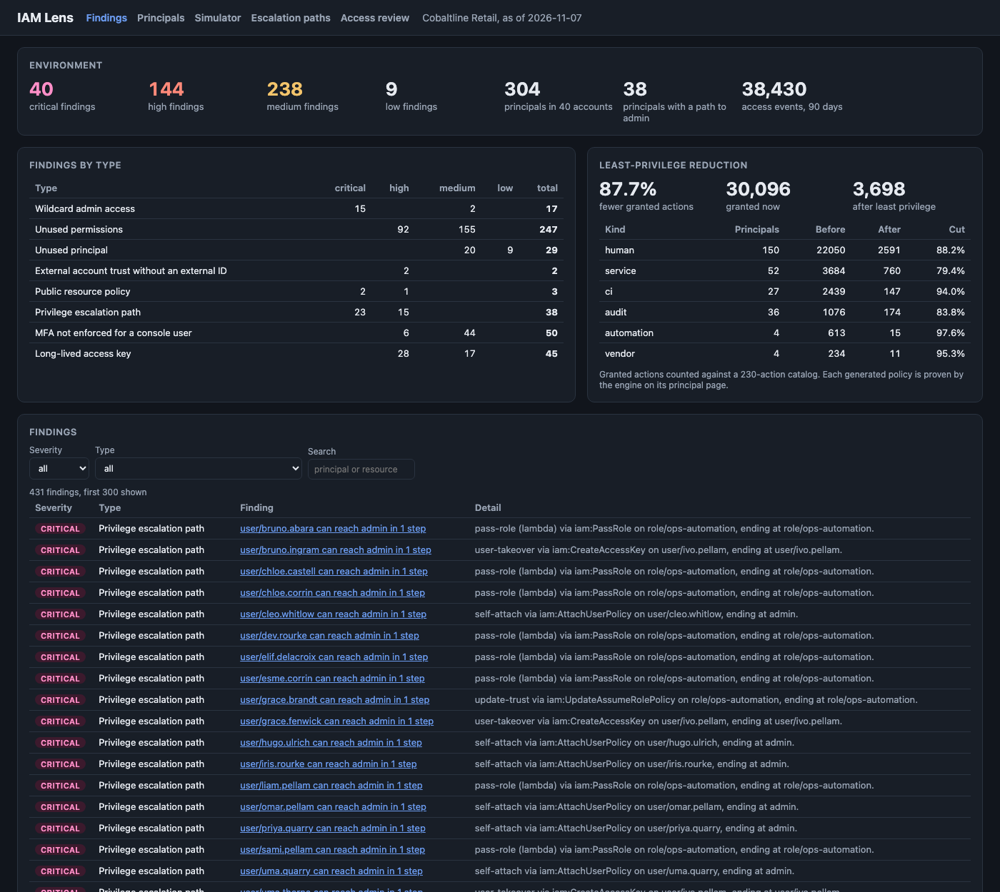
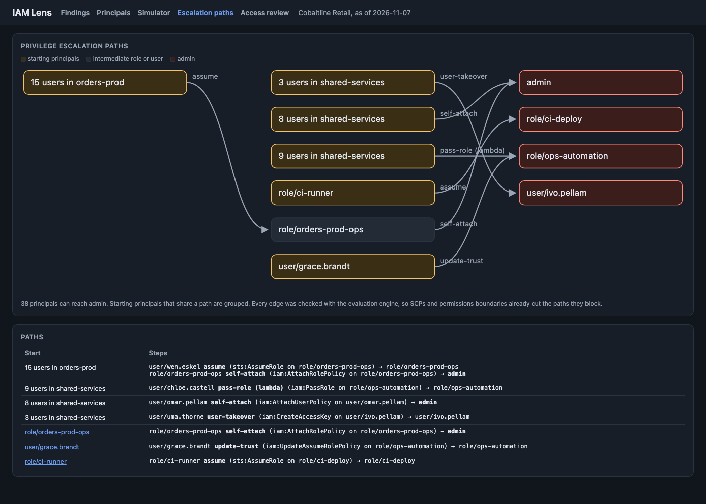
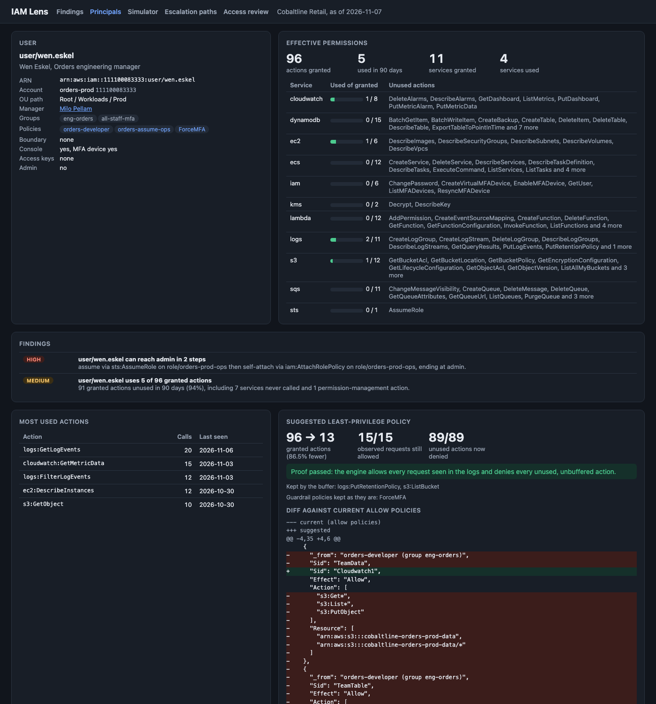
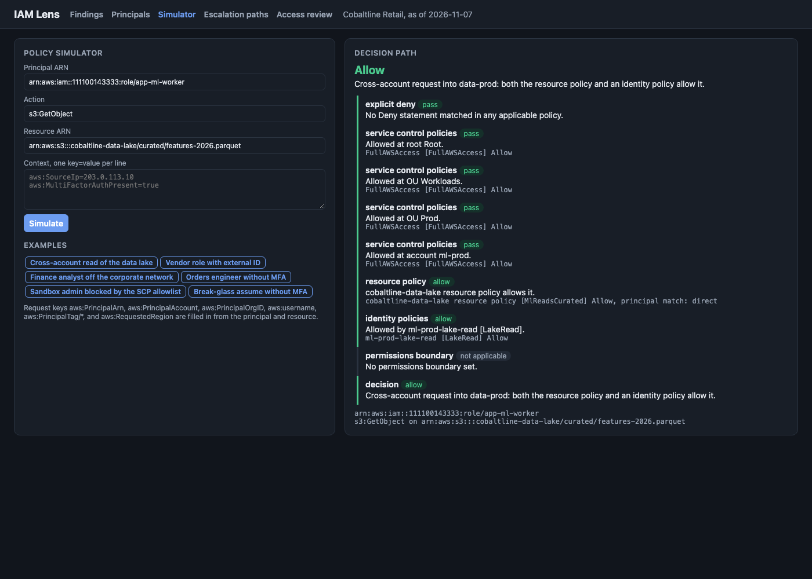

# IAM Lens

A cloud identity and access analyzer for Cobaltline Retail, a made-up online retailer with 40 accounts in an AWS-style organization. It implements the core IAM policy evaluation logic (explicit deny, service control policies, permissions boundaries, identity and resource policies, cross-account rules, wildcards, NotAction, conditions) and uses that engine for everything else: finding over-privileged identities, searching for privilege escalation paths, generating least-privilege policies from 90 days of access logs and proving them, running a manager access review, and gating policy changes in CI with SARIF output.



## Results on the example environment

304 principals (168 humans, 56 service roles and machine users, 27 CI roles, 40 audit roles, 5 vendor roles, 6 automation roles, 2 break-glass roles), 105 policies, 188 resources, 38,430 access events over 90 days. 431 findings:

| Finding | Critical | High | Medium | Low | Total |
|---|---:|---:|---:|---:|---:|
| Wildcard admin access | 15 | | 2 | | 17 |
| Unused permissions (granted vs used, service and action level) | | 92 | 155 | | 247 |
| Unused principal (no successful call in 90 days) | | | 20 | 9 | 29 |
| External account trust without an external ID | | 2 | | | 2 |
| Public resource policy | 2 | 1 | | | 3 |
| Privilege escalation path | 23 | 15 | | | 38 |
| MFA not enforced for a console user | | 6 | 44 | | 50 |
| Long-lived access key | | 28 | 17 | | 45 |

Least-privilege generation, for every principal with activity (break-glass excluded):

| Principal kind | Principals | Granted actions now | After | Cut |
|---|---:|---:|---:|---:|
| Human users | 150 | 22,050 | 2,591 | 88.2% |
| Service roles and machine users | 52 | 3,684 | 760 | 79.4% |
| CI roles | 27 | 2,439 | 147 | 94.0% |
| Audit roles | 36 | 1,076 | 174 | 83.8% |
| Automation roles | 4 | 613 | 15 | 97.6% |
| Vendor roles | 4 | 234 | 11 | 95.3% |
| **Total** | **273** | **30,096** | **3,698** | **87.7%** |

All 273 generated policies pass the proof: the engine allows every distinct request seen in the logs under the new policy, and denies every granted action that was not used and not kept by the buffer. Granted actions are counted against a 230-action catalog of the 20 services in use, so the "before" numbers undercount real wildcards by a wide margin.

What the numbers say:
- Most of the risk is in a few grants. 15 principals hold `Action *` on `Resource *` and 38 more can reach admin in one or two steps, mostly through `iam:PassRole` on `*`, helpdesk password resets on admin users, and an ops role any orders engineer can assume.
- SCPs and boundaries matter to the result. The three sandbox admin roles have `AdministratorAccess` but are not counted as admin, because the sandbox SCP allowlist removes IAM writes. Platform engineers have `iam:*`, but their permissions boundary removes self-attach, so their paths go through `iam:PassRole` instead.
- The unused-permission counts are where least privilege pays off: the median active human uses 12 actions and is granted 108.
- The generator and the analyzer were written together, so these numbers are a regression baseline for the method, not a claim about real estates. `make reduction` and `make findings` print them.

## Why

In most cloud estates, permissions only grow. Engineers get `PowerUserAccess` to unblock a launch, CI roles get admin because a deploy failed once, vendors get a role trusted by their account with no external ID, and nobody removes access when people change teams. The provider's documented evaluation logic is precise but hard to reason about across SCPs, boundaries, resource policies, and accounts, so teams cannot answer "who can actually do this?" without a simulator. This repo shows the engineering behind answering that question at scale: an evaluation engine with an explained decision path, findings that use the engine instead of string matching, least-privilege policies derived from real usage and proven before they ship, an access review that gives managers evidence instead of a spreadsheet, and a CI gate that stops new over-broad policies.

This is a teaching implementation of the evaluation logic. It is not a replacement for the provider's own policy simulator or access analyzer, and it does not cover every condition key, service, or edge case.

## What it does

**Evaluation engine** (`engine.py`, `policy.py`, `conditions.py`, `matching.py`). A request is a principal, an action, a resource ARN, and a context. The order:
1. Any matching `Deny` in an SCP, the permissions boundary, an identity policy, or the resource policy ends evaluation.
2. Every SCP level from the organization root down to the account must allow the action. The management account is exempt.
3. KMS key policies and role trust policies must allow the request. A grant to the account root delegates to identity policies.
4. Within one account, identity policies and a resource policy that names the principal are a union. Across accounts, both sides must allow.
5. A permissions boundary caps identity grants. It also caps a resource policy grant that names a role, but not one that names a user.

Wildcards follow the provider's rules: `*` and `?`, case-insensitive actions, case-sensitive ARNs matched segment by segment, `NotAction` and `NotResource`, and `${aws:username}` policy variables. Conditions: `StringEquals`, `StringNotEquals`, `StringLike`, `StringNotLike`, the `IgnoreCase` forms, `ArnLike`, `IpAddress`, `NotIpAddress`, `Bool`, `Null`, numeric comparisons, `...IfExists`, and `ForAnyValue` / `ForAllValues`, with the provider's missing-key behavior (positive operators false, negated operators true). The engine fills in `aws:PrincipalArn`, `aws:PrincipalAccount`, `aws:PrincipalOrgID`, `aws:username`, principal tags, and `aws:RequestedRegion`.

Every decision returns its path, for example a cross-account read of the data lake:

```
$ iamlens simulate 111100143333:role/app-ml-worker s3:GetObject arn:aws:s3:::cobaltline-data-lake/curated/features-2026.parquet
Allow: Cross-account request into data-prod: both the resource policy and an identity policy allow it.
  explicit deny              pass            No Deny statement matched in any applicable policy.
  service control policies   pass            Allowed at root Root.
  service control policies   pass            Allowed at OU Workloads.
  service control policies   pass            Allowed at OU Prod.
  service control policies   pass            Allowed at account ml-prod.
  resource policy            allow           cobaltline-data-lake resource policy allows it.
  identity policies          allow           Allowed by ml-prod-lake-read [LakeRead].
  permissions boundary       not applicable  No permissions boundary set.
```

**Findings** (`findings.py`, `usage.py`, `escalation.py`). Wildcard admin uses the engine to confirm the principal is effectively admin after SCPs. Unused permissions expand every Allow statement against the action catalog, apply SCPs, boundaries, and unconditional denies, and compare with actions that succeeded in the logs, per service and per action. External trust flags trust policies naming an account outside the organization without `sts:ExternalId` or `aws:PrincipalOrgID`. Public resource policies flag `Principal *` with no condition that limits the caller. MFA enforcement simulates each console user's most-used request with `aws:MultiFactorAuthPresent=false`. Access keys over 90 days are medium, over a year high.

**Escalation paths.** A graph where an edge means "A can become B", each checked with the engine: change your own policies (attach, put, new policy version, join an admin group), assume a role whose trust accepts you, pass a role to a new Lambda function, update a function's code to run as its role, rewrite a role's trust policy, or create keys or a login for another user. A breadth-first search from every non-admin principal finds the shortest path to admin.



**Least privilege** (`leastpriv.py`). From the actions a principal called successfully: group by service, keep the ARNs seen (S3 objects collapse to their prefix, more than 5 ARNs collapse to their common prefix), use `*` for list-only actions, keep a configurable buffer of rarely used actions (key rotation, snapshots, backups, retention changes) when they are already granted and the service is in use, and keep guardrail policies that contain a `Deny` as they are. Then prove it with the engine and report the reduction and a diff.



**Access review** (`campaign.py`). One item per human user and entitlement (group, attached policy, active access key), assigned to the user's manager, with a keep or revoke suggestion from usage. Only the current reviewer can decide, overriding a suggestion needs a comment, overdue items escalate to the next manager with a new due date, and the campaign closes when every item is decided. The evidence export (JSON or CSV) carries each decision, who made it and when, the suggestion and its evidence, the escalation chain, and a SHA-256 hash chain over the items so an auditor can detect edits.

**Simulator UI.**



## CI usage

```bash
iamlens check policies/ --base origin/main --sarif iamlens.sarif
```

Each `*.json` file is one policy document. With `--base`, only files changed since that ref are checked (`--changed FILE` is the explicit form). Rules: `IAM001` wildcard admin, `IAM002` Allow with NotAction, `IAM003` public resource policy, `IAM004` external trust without an external ID, `IAM005` escalation action on `Resource *`, `IAM006` whole service on `*`, `IAM007` invalid policy, `IAM008` old policy version. An optional `iamlens.json` in the folder lists the organization's account ids. Exit codes: `0` pass, `1` a finding at or above `--fail-on` (default `high`), `2` bad input. It writes SARIF 2.1.0 with `security-severity` per rule and a Markdown summary, appended to `$GITHUB_STEP_SUMMARY` when set.

This repo's CI runs the gate on `examples/policies` (passes, one medium finding), proves it exits 1 on `examples/policies-bad`, and uploads that SARIF with `continue-on-error` so the run stays green where code scanning is not enabled.

## Architecture

```
 examples/ (seeded generator)          core                                  outputs
 ┌──────────────────────────────┐   ┌────────────────────────────────┐   ┌───────────────────────────────┐
 │ environment.json             │   │ matching, conditions, policy   │   │ CLI: simulate, findings,      │
 │   org, OUs, 40 accounts,     │──▶│ engine.py  evaluation + path   │──▶│   suggest, reduction,         │
 │   SCPs, 105 policies,        │   │ usage.py   granted vs used     │   │   campaign, check (SARIF,     │
 │   304 principals, trust,     │   │ findings.py   8 finding types  │   │   $GITHUB_STEP_SUMMARY)       │
 │   188 resources + policies   │   │ escalation.py  graph + BFS     │   │ FastAPI: findings, principal, │
 │ access_logs.jsonl.gz         │   │ leastpriv.py  generate + prove │   │   simulate, least privilege,  │
 │   38,430 events, 90 days     │   │ campaign.py   reviews, export  │   │   escalation, campaigns,      │
 │ policies/, policies-bad/     │   │ check.py   static CI rules     │   │   /healthz, /metrics, JSON    │
 └──────────────────────────────┘   └────────────────────────────────┘   │ UI: dashboard, principal,     │
                                                                          │   simulator, graph, review    │
                                                                          └───────────────────────────────┘
```

Account ids are fictional placeholders in the provider's documentation style (`111122223333` for the management account, `1111NNNN3333` for the others, `444455556666` and similar for vendors). IP addresses come from the documentation ranges (`203.0.113.0/24`, `198.51.100.0/24`, `192.0.2.0/24`) and private space. The company, people, and vendors are made up.

## How to run

Without Docker (Python 3.12 and [uv](https://docs.astral.sh/uv/)):

```bash
make install       # uv sync --python 3.12
make findings      # critical and high findings
make reduction     # the least-privilege table above
make simulate      # the cross-account example above
make suggest       # a generated policy and its proof
make check         # CI gate on the clean examples (exit 0), writes iamlens.sarif and summary.md
make check-bad     # CI gate on the bad examples (exit 1)
make run           # API and UI on http://127.0.0.1:8839
```

`make data` regenerates `examples/` from seed 7 (about 7 seconds). The server takes about 8 seconds to load because it runs every finding and the escalation search at startup. Campaign state goes to `data/campaigns.json`.

API:

```bash
curl -s 'localhost:8839/api/findings?severity=critical&type=privilege_escalation' | head -c 600
curl -s 'localhost:8839/api/principal?arn=arn:aws:iam::111100083333:user/wen.eskel' | head -c 600
curl -s -XPOST localhost:8839/api/simulate -H 'content-type: application/json' -d '{
  "principal": "arn:aws:iam::111100083333:user/wen.eskel", "action": "dynamodb:GetItem",
  "resource": "arn:aws:dynamodb:us-east-1:111100083333:table/orders-prod",
  "context": {"aws:MultiFactorAuthPresent": "false"}}'
curl -s 'localhost:8839/api/least-privilege?arn=arn:aws:iam::111100083333:user/wen.eskel&max_resources=5'
curl -s localhost:8839/api/least-privilege/summary
curl -s localhost:8839/api/escalation
curl -s -XPOST localhost:8839/api/campaigns -H 'content-type: application/json' -d '{"name":"Q4","deadline":"2026-11-21"}'
curl -s -XPOST localhost:8839/api/campaigns/C-001/escalate -H 'content-type: application/json' -d '{"now":"2026-11-25"}'
curl -s 'localhost:8839/api/campaigns/C-001/evidence?format=csv' | head
curl -s localhost:8839/metrics
```

Docker: `make docker-build`, then `docker run -p 8839:8839 iam-lens`. Docker is not installed on the machine this was built on, so the image is built and smoke tested in CI only.

## Tests

114 tests, `make test` (about 45 seconds). They cover:
- Action and ARN wildcards, segment rules, case rules, and policy variables.
- Each condition operator, `IfExists`, `Null`, missing-key behavior, AND across operators and keys, OR across values, set operators, and grammar validation.
- A table of 27 hand-written evaluation cases: deny precedence, SCP explicit deny and allowlists, the region lock, the management account exemption, boundaries (including the user versus role rule for resource policy grants), same-account union, cross-account rules for S3 and role trust, KMS key policy delegation, external IDs, MFA, IP conditions, NotAction.
- Each finding type on the example environment, plus external trust and public policy detection on small policies.
- Escalation search on a hand-built environment with every edge kind, an SCP cutting two paths, and the boundary cutting self-attach on the examples.
- Least-privilege shape (prefix collapse, list-only actions, denied calls excluded), the buffer, a proof on 11 example principals, and that the proof catches both a too-narrow and a too-wide policy.
- Campaign suggestions, reviewer authorization, override comments, escalation up the chain, closing, persistence, and tamper detection in the evidence chain.
- Static CI rules, line numbers, SARIF shape, Markdown summary, exit codes, `--changed`, and `--base` against a real temporary git repository.
- The API end to end, and generator determinism.

## Production notes

- **Read the real sources.** Pull account authorization details, SCPs, and resource policies from the provider's APIs on a schedule, and access history from the audit log pipeline (or the provider's last-accessed data), into a store keyed by principal ARN and policy version.
- **Use the provider's evaluator as the source of truth.** Keep a local engine for speed and explanations, but sample its answers against the provider's simulator and access analyzer in CI, and fail loudly on any disagreement.
- **Load the full action catalog.** The provider publishes over 15,000 actions with their resource types and condition keys. Wildcard expansion and the "granted" counts need all of them.
- **Ship least privilege gradually.** Open a pull request per principal with the generated policy, run it in a dry-run mode that logs would-be denies for two weeks, and keep the buffer list owned by the service team.
- **Reviews need identity and an audit trail.** Reviewer identity comes from SSO, decisions are append-only, revocations flow into a ticket or an automated detach, and the evidence export is signed and stored where auditors can retrieve it.
- **Run the escalation search on every change**, not just nightly: a new trust policy or a widened `iam:PassRole` can open a path that no single-policy rule sees.

## License

MIT. See [LICENSE](LICENSE).
